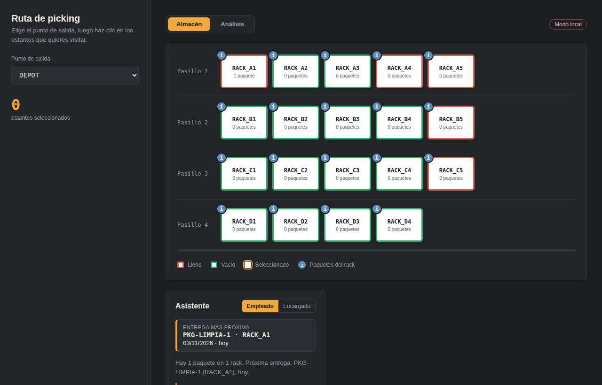
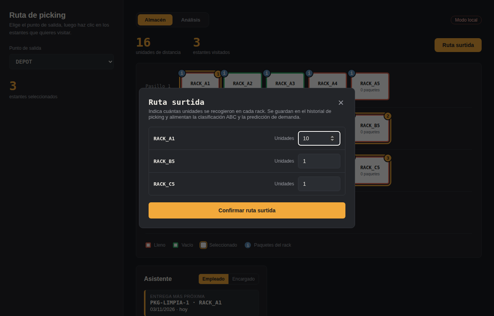
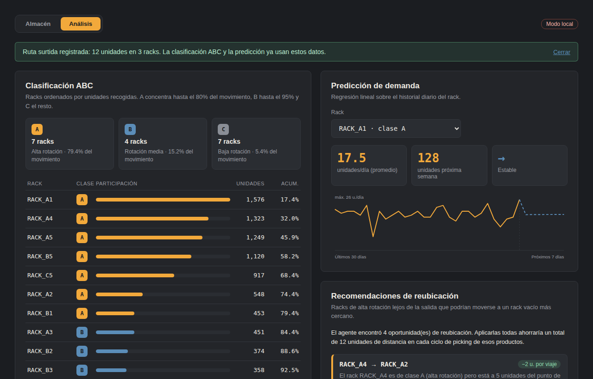

# Bitácora: instalación en carpeta limpia, en modo local

Fecha: 2026-11-03. Se siguió **solo el README** del proyecto, en una carpeta limpia (sin `.env`, sin `node_modules`, sin datos previos): backend con base de datos, `seed.py`, `seed_historial.py`, frontend y pruebas.

## Alcance y límite de esta prueba

El entorno donde se ejecutó **no tiene Docker**, así que `docker compose` no se corrió aquí. Cada paso se reprodujo con las mismas piezas que usa Docker:

| Paso del README | Cómo se probó aquí |
|---|---|
| `docker compose up` (servicio `db`) | PostgreSQL 16 real (la misma versión de la imagen `postgres:16`), con usuario, contraseña y base tomados del `.env` |
| `docker compose up --build` (servicio `api`) | `pip install -r requirements.txt` en un entorno limpio con Python 3.12, como el `Dockerfile`, y `uvicorn main:app` con las variables que resuelve `docker-compose.yml` |
| Variables de `docker-compose.yml` | Resueltas con la misma regla de Compose (`${V:-valor}`, `${V:?mensaje}`, `$$`) |
| `docker compose exec api python seed*.py` | Los mismos scripts, con las variables del contenedor |
| Pruebas, forma Docker y forma local | Las dos, tal cual las documenta el README |
| Frontend | `npm install`, `npm run build`, `npm run dev` y un recorrido en un navegador real |

**No se verificó aquí:** la construcción de la imagen, la red de Compose y el `healthcheck` de la base. Para eso está el script `probar_instalacion_docker.ps1` (en esta carpeta), que repite la prueba con Docker real en una máquina con Docker y guarda su propia bitácora como `instalacion_docker_<fecha>.txt`. Esa bitácora debe agregarse aquí cuando se ejecute.

## Commit probado en cada prueba

| Prueba | Fecha | Commit o etiqueta probado | Resultado | Evidencia |
|---|---|---|---|---|
| Corrida 1 (hallazgos), sin Docker | 2026-11-03 | Contenido equivalente al del commit `954f56f` (snapshot 0.12). Se probó una copia del contenido, no un clon | 1 hallazgo importante y 2 menores | Sección «Hallazgos» de esta bitácora |
| Corrida 2 (con correcciones), sin Docker | 2026-11-03 | Contenido de la etiqueta `v0.14-snapshot` (se obtiene con `git rev-parse --short v0.14-snapshot`). Se probó una copia del contenido antes de hacer el commit | 36 de 36 pasos correctos | Tabla de la corrida 2 de esta bitácora |
| Docker real (Windows y Docker Desktop) | Pendiente | Lo registra el script (línea «Commit probado») | Pendiente | `instalacion_docker_<fecha>.txt` |

Para la prueba con Docker real, el script `probar_instalacion_docker.ps1` clona el repositorio, imprime el commit que clonó y al final muestra la fila lista para pegar en esta tabla.

## Entorno

Linux 6.18.44-fc-v230 (contenedor de pruebas), Python 3.12.3, Node v22.22.2, npm 10.9.7, psql (PostgreSQL) 16.15 (Ubuntu 16.15-0ubuntu0.24.04.1)

## Hallazgos de la primera corrida y correcciones

La primera corrida se hizo sobre el repositorio tal cual estaba (snapshot 0.12). Todo funcionó salvo lo siguiente:

| # | Hallazgo | Corrección | Comprobado en la corrida 2 |
|---|---|---|---|
| 1 | Si `seed.py` se ejecuta antes de que la API haya arrancado (la primera vez tarda unos segundos), falla porque las tablas aún no existen, y **termina con código 0**, así que el error pasa casi desapercibido. Mensaje observado: `Error al poblar la base de datos: (psycopg2.errors.UndefinedTable) relation "ubicaciones_racks" does not exist LINE 2: FROM ubicaciones_racks ^ [SQL: SELECT ubicaciones_…` | `seed.py` y `seed_historial.py` crean las tablas si faltan y terminan con código 1 si fallan | Sembrar antes de la API funciona; con la base inaccesible el código de salida es 1 |
| 2 | Las plantillas `.env.example` tenían acentos. Windows PowerShell 5.1 lee y reescribe archivos sin UTF-8, y el README pide editarlas con `Get-Content`/`Set-Content`. *Riesgo preventivo: no se observó una falla.* | Las plantillas quedan solo con caracteres ASCII | Edición con los comandos del README sin cambios de codificación |
| 3 | Para el modo local había que combinar dos secciones del README (levantar y modo local), con la edición del `.env` hecha a mano | Nueva sección "Inicio rápido (modo local)" con los comandos exactos, incluida la edición del `.env` | Todos los comandos de esa sección se ejecutaron tal cual |

Observación: en esta máquina `npm install` usó la caché local de npm, por lo que tardó pocos segundos; en un equipo nuevo tardará más.

## Resultado de la corrida 2 (con las correcciones)

36 de 36 pasos correctos.

| # | Paso | Resultado | Tiempo | Detalle |
|---|---|---|---|---|
| 1 | Carpeta limpia (copia del repositorio, sin .env ni node_modules) | Correcto | 0.0 s | 67 archivos |
| 2 | docker compose sin .env avisa con un mensaje claro | Correcto | 0.0 s | Falta POSTGRES_PASSWORD. Copia .env.example como .env y define la contraseña |
| 3 | Copy-Item .env.example .env | Correcto | 0.0 s |  |
| 4 | Editar .env: POSTGRES_PASSWORD y AUTH_DISABLED=true | Correcto | 0.0 s |  |
| 5 | docker-compose.yml resuelto con ese .env (variables que recibe la API) | Correcto | 0.0 s | POSTGRES_USER=postgres |
| 6 | Imagen: python -m venv (equivale a FROM python:3.12-slim) | Correcto | 4.1 s |  |
| 7 | Imagen: pip install --no-cache-dir -r requirements.txt (RUN del Dockerfile) | Correcto | 53.6 s | _x86_64.whl (221 kB) |
| 8 | Imagen: versiones instaladas | Correcto | 0.0 s | fastapi==0.141.1 |
| 9 | Servicio db: PostgreSQL 16 vacío con la clave del .env | Correcto | 0.0 s | PostgreSQL 16.15 (Ubuntu 16.15-0ubuntu0.24.04.1) on x86_64-pc-linux-gnu, compile |
| 10 | Seed antes de que la API cree las tablas | Correcto | 0.4 s | ¡Base de datos poblada con éxito! |
| 11 | API arriba (uvicorn main:app) | Correcto | 0.0 s | lista en 2.6s |
| 12 | http://localhost:8000/docs | Correcto | 0.0 s | HTTP 200, aviso 'Modo local' presente: True |
| 13 | python seed.py (dentro del contenedor) | Correcto | 0.7 s | ¡Base de datos poblada con éxito! |
| 14 | python seed_historial.py (dentro del contenedor) | Correcto | 1.7 s | ¡Historial de picking poblado con éxito! (1620 registros nuevos) |
| 15 | Seed con la base inaccesible termina con error (código 1) | Correcto | 0.4 s | un2/venv_imagen/lib/python3.12/site-packages/sqlalchemy/pool/base.py", line 674, in __init__ |
| 16 | GET /api/v1/ubicaciones | Correcto | 0.0 s | 20 ubicaciones (esperadas: 20) |
| 17 | GET /api/v1/analisis-abc | Correcto | 0.0 s | HTTP 200, 18 racks clasificados |
| 18 | GET /api/v1/prediccion-demanda/RACK_A1 | Correcto | 0.0 s | HTTP 200, tendencia: estable |
| 19 | GET /api/v1/recomendaciones-espacio | Correcto | 0.0 s | HTTP 200, 4 recomendaciones |
| 20 | POST /api/v1/optimizar-ruta-bd | Correcto | 0.0 s | HTTP 200, distancia 16 |
| 21 | Paquete + mensajes del asistente (PostgreSQL real) | Correcto | 0.0 s | crear paquete HTTP 201; mensajes HTTP 200, 1 mensaje(s) |
| 22 | Pruebas, forma Docker: pip install -q pytest httpx | Correcto | 5.9 s |  |
| 23 | Pruebas, forma Docker: python -m pytest | Correcto | 15.0 s | ........................ [100%] |
| 24 | Pruebas, forma local: python -m venv .venv | Correcto | 3.3 s |  |
| 25 | Pruebas, forma local: pip install -r requirements-dev.txt | Correcto | 39.4 s |  |
| 26 | Pruebas, forma local: python -m pytest | Correcto | 2.9 s | ........................ [100%] |
| 27 | Frontend: Copy-Item .env.example .env | Correcto | 0.0 s |  |
| 28 | Frontend: editar .env (VITE_AUTH_DISABLED=true) | Correcto | 0.0 s |  |
| 29 | Frontend: npm install | Correcto | 4.4 s | added 24 packages in 4s |
| 30 | Frontend: npm run build (comprobación de compilación) | Correcto | 0.9 s | > frontend@0.12.0 build |
| 31 | Frontend: npm run dev (http://localhost:5173) | Correcto | 0.0 s |  |
| 32 | Navegador: pantalla Almacén | Correcto | 0.0 s | 19 racks en el mapa, etiqueta 'Modo local' |
| 33 | Navegador: calcular ruta óptima de 3 racks | Correcto | 0.0 s | distancia total: 3 |
| 34 | Navegador: botón «Ruta surtida» guarda el picking real | Correcto | 0.0 s | RACK_A1: 1566 -> 1576 unidades en la clasificación ABC; total +12 |
| 35 | Navegador: pestaña Análisis (ABC, predicción, recomendaciones) | Correcto | 0.0 s | 18 racks en la clasificación ABC, gráfica de predicción visible, 4 recomendaciones |
| 36 | Navegador: errores de consola (sin contar la descarga de fuentes de Google) | Correcto | 0.0 s | ninguno |

## Evidencias

Pantalla Almacén (con la base en PostgreSQL):

Ventana de «Ruta surtida» (registro del picking real):

Vista de análisis con la clasificación ABC, la predicción y las recomendaciones:

## Cómo repetir la prueba con Docker real

1. Detén tu propio proyecto si está corriendo (`docker compose down` en la carpeta del backend), porque usa los puertos 8000, 5173 y 5432.
2. Desde esta carpeta (`docs\evidencias`), ejecuta `.\probar_instalacion_docker.ps1` (si Windows lo bloquea por venir de internet: `Unblock-File .\probar_instalacion_docker.ps1`).
3. El script clona el repositorio en una carpeta temporal, sigue los pasos del README, borra sus propios contenedores al terminar y guarda `instalacion_docker_<fecha>.txt` aquí. El archivo incluye el commit que se clonó y la fila lista para pegar en la tabla «Commit probado en cada prueba» de esta bitácora.
